# XchangeFinder — Flat GitHub Edition

**Team 17 — SocGen Finhack 2017**

XchangeFinder is a legacy Flask-based exchange-shop finder and rate-comparison project. It includes the original web application source, SQLite database, analysis notebook, Streamlit dashboard, multi-language CLI examples, and generated charts.

## Repository layout

This edition is deliberately **flat**: every project file is stored in the repository root, with former directory names joined using `__`.

Examples:
- `app__views.py` — Flask routes and application logic
- `app__templates__index.html` — original Jinja template
- `app__static__style.css` — original stylesheet
- `db__XchangeFinder.db` — SQLite database
- `notebooks__XchangeFinder_Exploration.ipynb` — analysis notebook
- `streamlit_app__app.py` — Streamlit dashboard source
- `cli__c__xfinder.c`, `cli__cpp__xfinder.cpp`, `cli__go__main.go` — CLI implementations
- `docs__architecture_diagram.png` — architecture diagram

No subdirectories are required for storing this flat source archive.

## Diagrams & Visuals

### System architecture

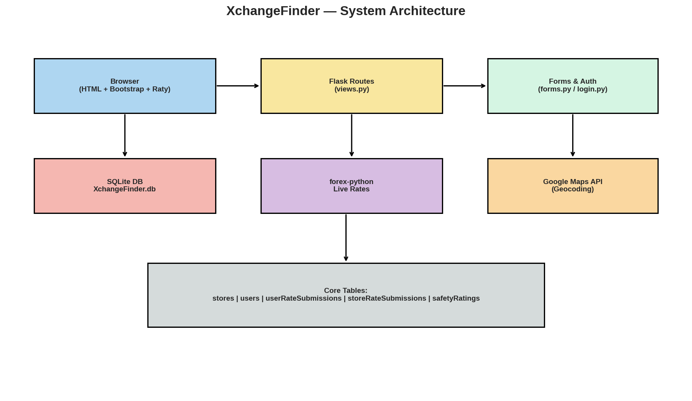

The browser talks to Flask routes (`app__views.py`), which use the forms/auth layer, the SQLite database, live rates from `forex-python`, and Google Maps geocoding. The five core tables are `stores`, `users`, `userRateSubmissions`, `storeRateSubmissions` and `safetyRatings`.

### Data flow

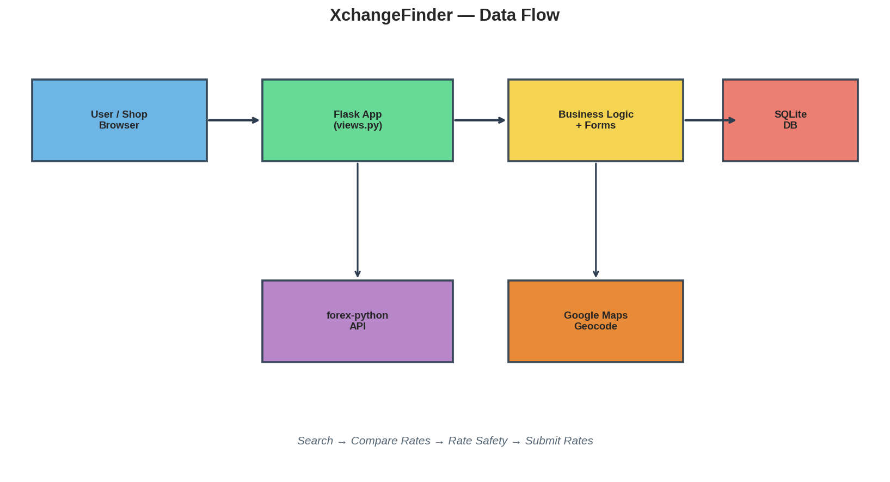

User journey: **Search → Compare Rates → Rate Safety → Submit Rates**.

### Interactive-style flow (Mermaid)

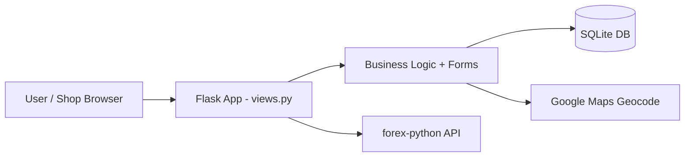

### 3D visuals

| Rate difference (3D) | Geo safety (3D) | Submissions (3D) |
|---|---|---|
| 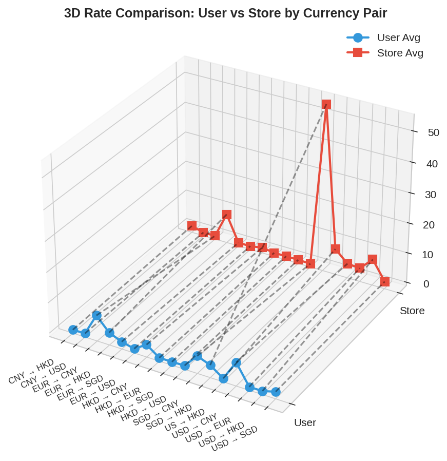 | 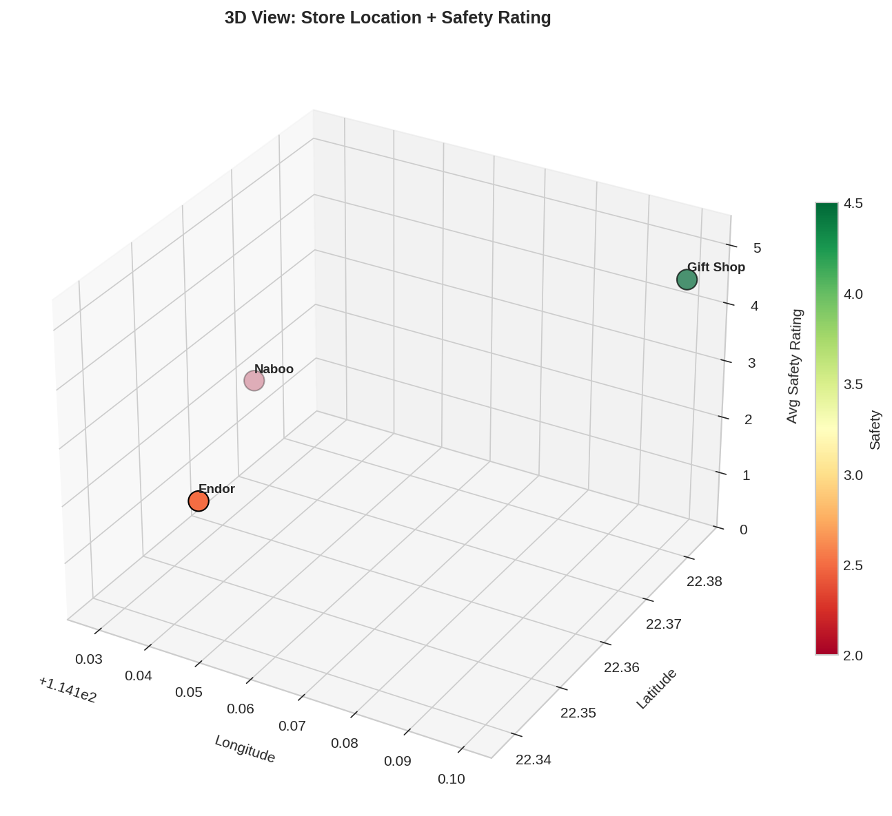 | 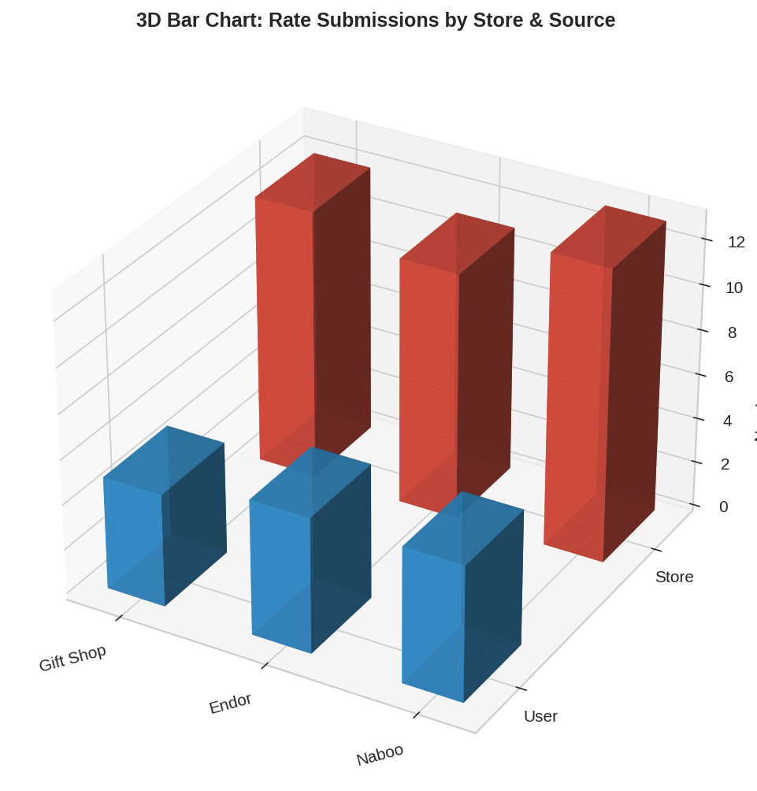 |

### Analysis charts

| Safety distribution | Safety bar chart |
|---|---|
| 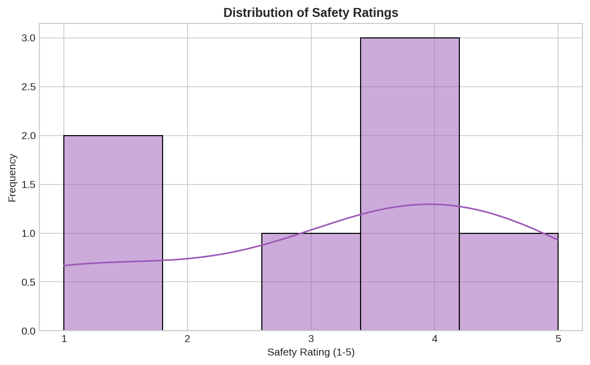 | 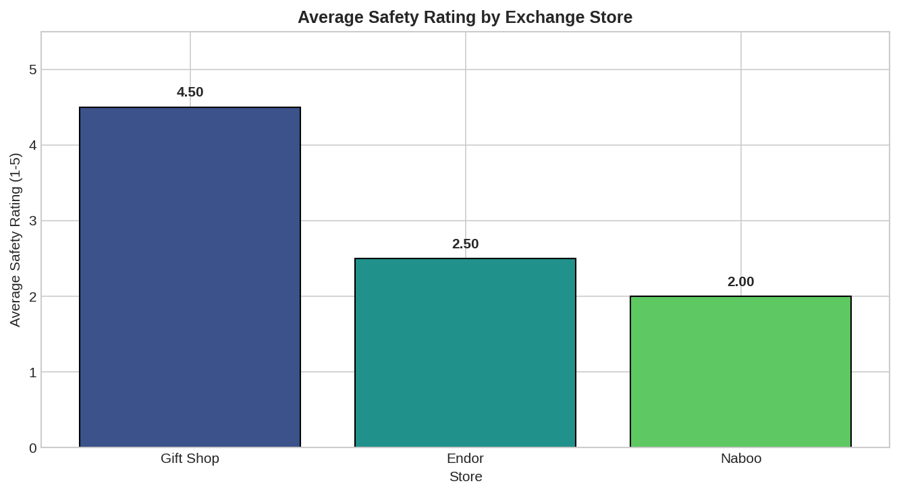 |

| Rate heatmap | Rate boxplot |
|---|---|
| 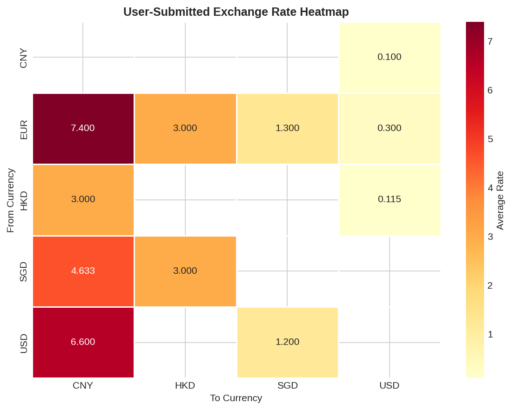 | 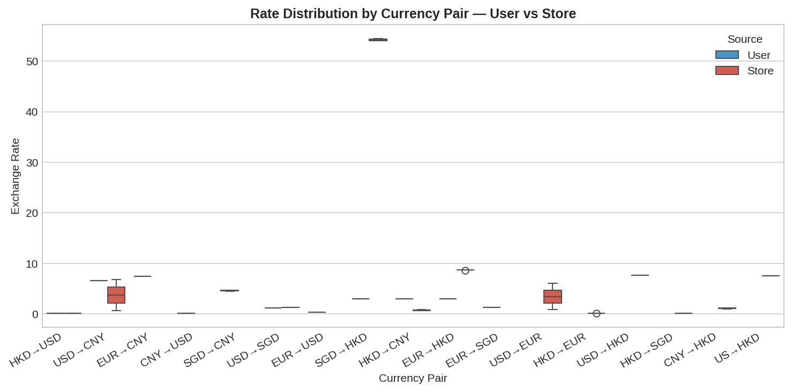 |

| Submissions comparison | Top users |
|---|---|
| 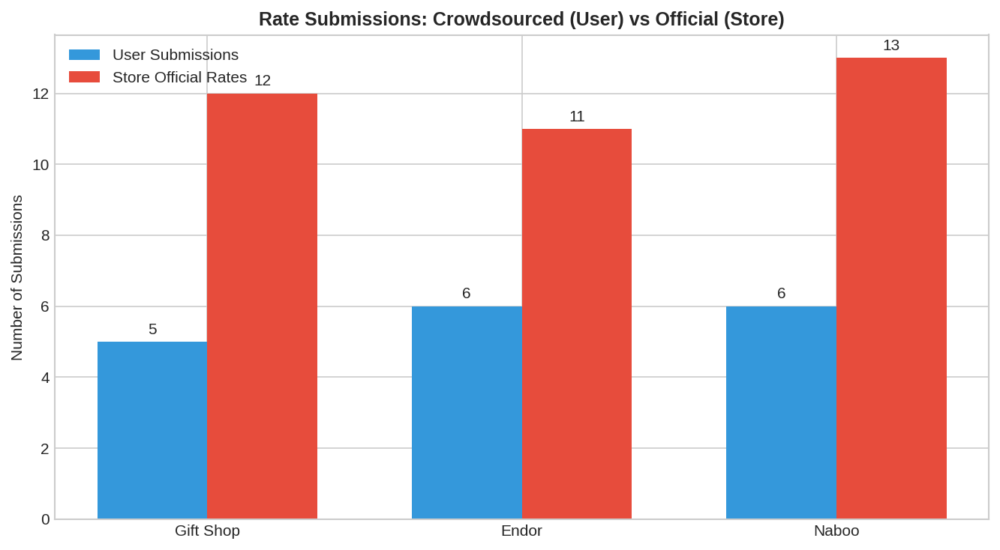 | 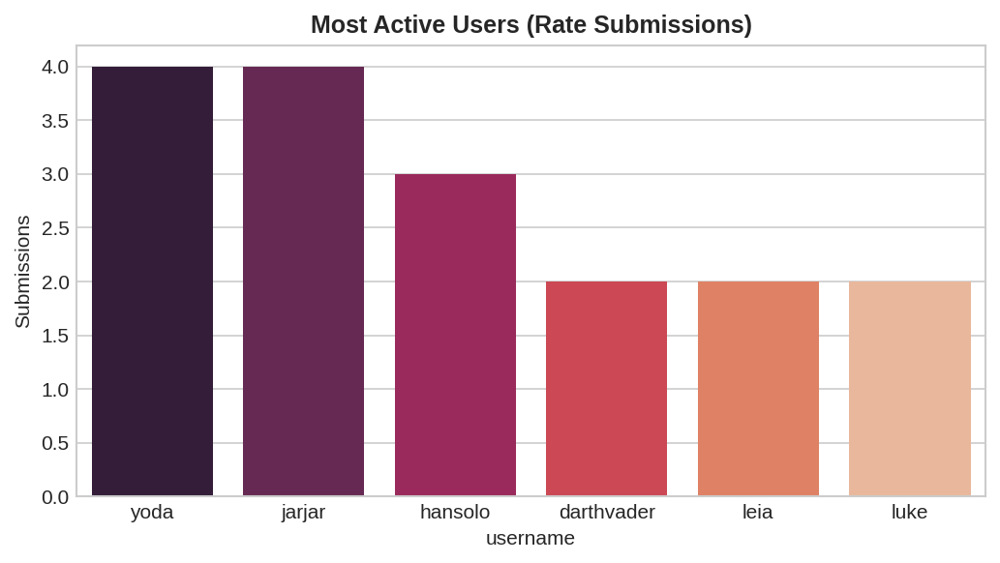 |

| Correlation heatmap | Geo map (2D) |
|---|---|
| 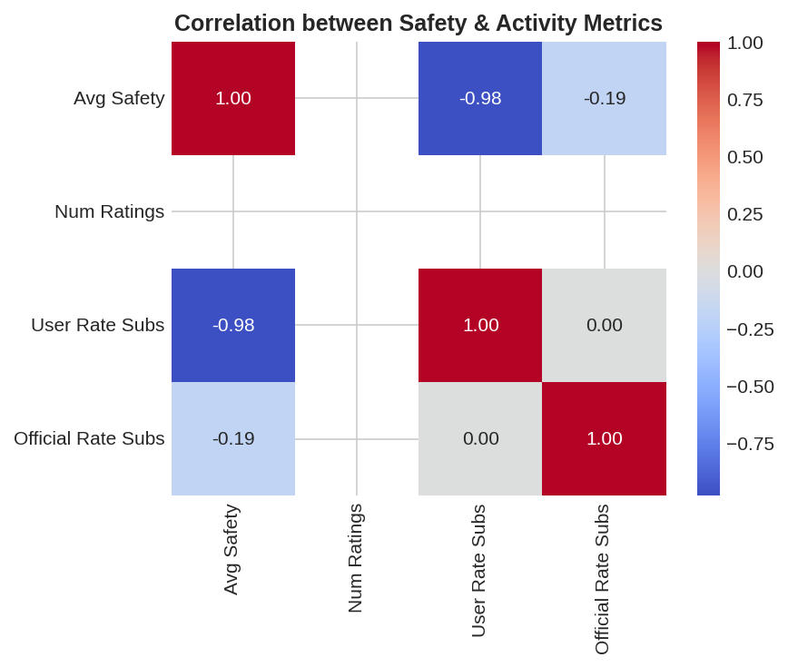 | 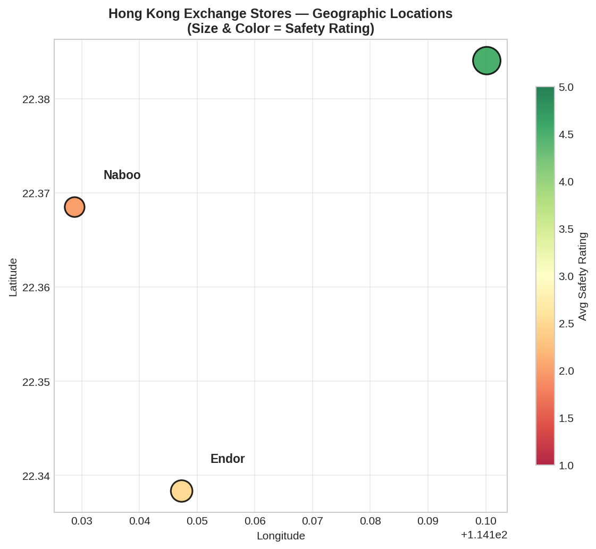 |

### Comparison tables

- `docs__rate_comparison_table.csv` — exchange-rate comparison data
- `docs__store_comparison_table.csv` — store comparison data

## Important runtime note

This is a **flat source-layout export**, not a path-refactored application release. The original Flask, Streamlit, notebook, and CLI files may refer to their former directory paths (for example, Flask expects templates and static assets in conventional folders). To run those components, restore their original directory layout or update their path configuration/references first. The flat layout is suitable for browsing, versioning, and publishing the complete source collection on GitHub.

The original application is legacy software from 2017. Review and update dependencies, credentials, database paths, and security settings before deployment. In particular, replace the development secret key and configure any required external API keys.

## Included components

- Flask web application source and Jinja templates
- Static CSS, JavaScript, image, and font assets
- SQLite database and CSV data exports
- Jupyter exploration notebook
- Streamlit dashboard
- Bash, C, C++, and Go CLI implementations
- Architecture/data-flow diagrams and analysis charts

## Original technology stack

Python, Flask, SQLite, Flask-Login, Flask-WTF, WTForms, Bootstrap, forex-python, Jupyter, pandas, matplotlib, seaborn, Plotly, Streamlit, Bash, C, C++, and Go.

## License

Original hackathon project (2017). Use for educational purposes; verify third-party asset and dependency licenses before redistribution.
